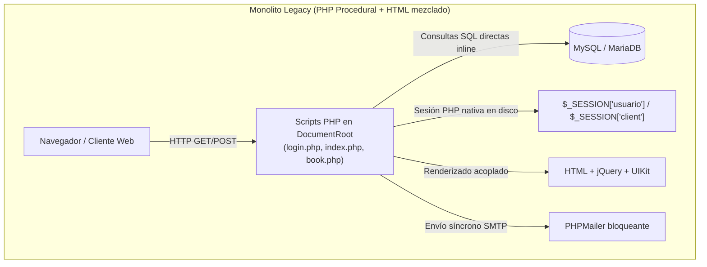
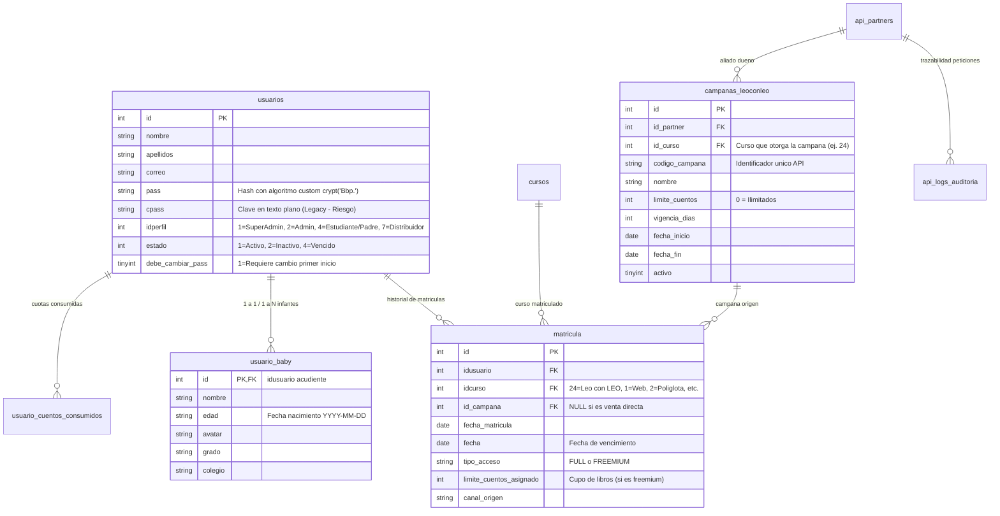

# 🔍 Análisis Arquitectónico del Monolito Actual: Bebé Genial (Aula Virtual)

**Ubicación del Código Fuente Actual:** `D:\xampp\htdocs\aula`  
**Base de Datos Actual:** MySQL / MariaDB (`bebegenial_pruebas` / `bebegenial_produccion`)  
**Fecha de Análisis:** Octubre 2026  
**Autor:** Equipo de Arquitectura Nuvex Tecnología  

---

## 1. Resumen Ejecutivo y Diagnóstico

La plataforma actual de **Bebé Genial** opera como un monolito en **PHP procedural (versiones 7.4 / 8.x)**, donde la lógica de negocio, las consultas directas a base de datos (`mysqli`), las directivas de sesión de servidor (`$_SESSION`) y el renderizado HTML (vía UIKit 3, Bootstrap 4 y jQuery) conviven en los mismos archivos scripts.

Aunque la plataforma ha sido comercialmente exitosa y cuenta con miles de familias activas, su arquitectura actual presenta serias limitaciones para escalar, incorporar aplicaciones móviles nativas, mantener interfaces reactivas y desacoplar responsabilidades.



---

## 2. Inventario de Módulos del Sistema Actual

| Directorio / Componente | Funcionalidad en el Negocio | Deuda Técnica / Acoplamiento |
| :--- | :--- | :--- |
| **`admin/`** | Panel de administración central: usuarios, matrículas, cursos, roles, Wompi, reportes y convenios. | Scripts `.php` independientes que invocan `config.php`, validación de roles en cabecera mediante `$_SESSION['admin']['perfil']`. |
| **`api/v1/leoconleo/`** | Endpoint B2B moderno para registro de campañas desde plataformas aliadas (ej. GHL, Colsubsidio). | Construido recientemente con estándar REST, OOP y JSON, listo para integrarse directamente a Laravel. |
| **`cuentos-leo-con-leo/`** | Biblioteca de cuentos interactivos bilingües. Incluye estanterías por edad y visor Flipbook (`cuento/book.php`) con audio karaoke sincronizado. | Lectura de páginas e imágenes desde disco local con control server-side recién implementado (`verificar_permiso_cuento.php`). |
| **`metodo-bebe/`** | Videos y lecciones de estimulación temprana infantil (Método Bebé Políglota). | Archivos estáticos embebidos en iframes y reproductores HTML5 acoplados a la sesión de PHP. |
| **`distribuidor/`** | Portal exclusivo para aliados comerciales (perfil 7): matrícula de alumnos y reportes en Excel. | Duplica lógica de inserción de alumnos de `admin/usuarios/crear.php`. |
| **`wompi/`** | Pasarela de pagos: checkout público, suscripciones recurrentes y recepción de webhooks. | Manejo síncrono de eventos, lógica de actualización de matrícula dispersa entre callbacks y scripts de retorno. |
| **`games/` y `abecedario/`** | Juegos interactivos en HTML5/JavaScript para estimulación cognitiva del menor. | Totalmente estáticos; leen datos de usuario vía variables globales inyectadas en PHP. |
| **`contratos/` y `documentos/`** | Generación de contratos PDF, formatos DC3 y diplomas de graduación. | Usa librerías legacy como FPDF / DOMPDF procedural; generación intensiva en CPU sin colas. |
| **`cron/`** | Scripts de vencimiento de matrículas, cálculo de días restantes y recordatorios de pago. | Invocados por tareas programadas del sistema operativo; no tienen idempotencia ni logs estructurados. |

---

## 3. Mapeo del Modelo de Datos (Tablas Clave)



---

## 4. Hallazgos Críticos y Deuda Técnica Detectada

### 🚨 Riesgo 1: Mecanismo de Hashing de Contraseñas Legacy
* **Problema:** En el código actual, la función `clave($pass)` utiliza:
  ```php
  crypt($pass, 'Bbp.'); // o MD5 en registros antiguos
  ```
  Adicionalmente, existe una columna `cpass` que en ciertos flujos almacena contraseñas sin cifrar o temporales.
* **Impacto en Migración:** Laravel por defecto usa `bcrypt` o `argon2id`. No podemos simplemente reiniciar las contraseñas de todos los clientes activos.
* **Estrategia requerida:** Crear un **Custom Password Hasher** en Laravel que verifique contra el algoritmo legacy y actualice en caliente a `bcrypt` en el primer inicio de sesión del usuario.

### 🚨 Riesgo 2: Dependencia de Sesiones PHP Nativas en Disco
* **Problema:** Múltiples módulos validan acceso leyendo `$_SESSION['usuario']`, `$_SESSION['admin']` o `$_SESSION['client']`.
* **Impacto en Migración:** Angular requiere un esquema **Stateless basado en Tokens / Cookies HttpOnly seguras (Laravel Sanctum)**. La sesión no puede residir en variables superglobales de PHP.

### 🚨 Riesgo 3: Acoplamiento de Cuentos Multimedia y Flipbook
* **Problema:** El visor de cuentos (`cuentos-leo-con-leo/cuento/book.php`) genera páginas HTML embebidas con iframes, audios sincronizados e imágenes leídas directamente de rutas relativas locales.
* **Impacto en Migración:** En una arquitectura desacoplada, el backend debe exponer un API que devuelva la metadata del libro (páginas, timestamps de audio, títulos) y URLs firmadas de corta duración (`Signed URLs`) para proteger el material pedagógico contra descargas no autorizadas.

### 🚨 Riesgo 4: Tareas Programadas y Webhooks Síncronos
* **Problema:** Los webhooks de Wompi y los correos de bienvenida se envían de forma síncrona en el hilo principal de la petición HTTP. Si el servidor SMTP se retrasa, el API o el checkout fallan con timeout.
* **Impacto en Migración:** Implementar **Laravel Queues & Jobs** respaldado por Redis para procesar webhooks y correos en milisegundos sin congelar al cliente.
