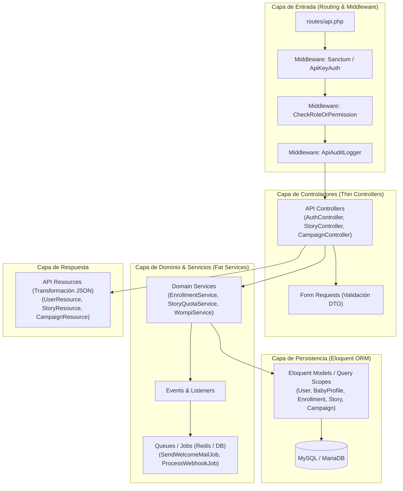
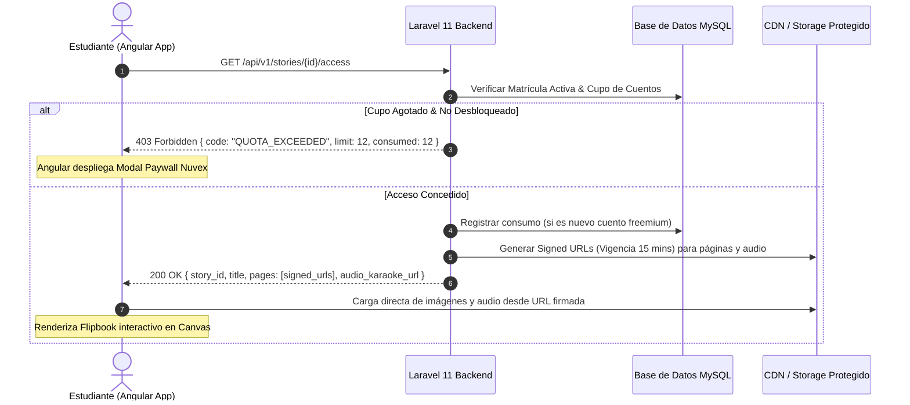

# 🏛️ Arquitectura Objetivo del Backend: Laravel 11+ (API First)

**Proyecto:** Ecosistema Bebé Genial  
**Tecnología Base:** PHP 8.3 / Laravel 11+  
**Paradigma:** RESTful API First + Modular Domain Architecture  
**Fecha:** Octubre 2026  
**Autor:** Equipo de Arquitectura Nuvex Tecnología  

---

## 1. Principios de Diseño de la Nueva Arquitectura

1. **Desacople Total de la Presentación:** El backend **no renderiza HTML**. Exclusivamente procesa solicitudes HTTP, ejecuta reglas de negocio, persiste datos y retorna respuestas estructuradas en **JSON (JSON:API / Estándar Nuvex)**.
2. **Autenticación Unificada Stateless:** Basada en **Laravel Sanctum**. Soporta autenticación de SPA (Angular) mediante Cookies `HttpOnly` protegidas contra XSS/CSRF, y autenticación para aliados B2B mediante cabeceras `X-API-KEY` o `Bearer Tokens`.
3. **Migración Transparente de Contraseñas:** Soporte para el algoritmo legacy (`crypt('Bbp.')`) con re-hashing automático en background hacia `bcrypt`.
4. **Manejo Asíncrono de Operaciones Pesadas:** Correos SMTP, procesamiento de webhooks de Wompi y generación de contratos PDF delegados a **Colas (Laravel Queues con Redis o Database Driver)**.
5. **Seguridad y Control de Acceso por Políticas:** Manejo estricto de roles mediante `Policies` y `Gates` de Laravel (SuperAdmin, Admin, Distribuidor, Padre/Estudiante).
6. **Aislamiento Total con Base de Datos Nueva (`bebegenial_desacople`):** El nuevo backend **no se conecta a la base de datos de producción actual para escribir**. Se crea una base de datos completamente nueva, limpia y normalizada bajo estándares modernos (`snake_case`, claves foráneas estrictas, eliminación de columnas de texto plano como `cpass`, índices optimizados). Los datos históricos se transferirán al final mediante un proceso formal de **ETL (Extracción, Transformación y Carga)** automatizado.



---

## 2. Estructura de Directorios Propuesta en Laravel 11

Para evitar controladores monolíticos, organizamos el código por **Módulos de Dominio**:

```
bebegenial-backend/
├── app/
│   ├── Hashing/
│   │   └── LegacyBbpHasher.php             <-- Driver para validar claves legacy
│   ├── Http/
│   │   ├── Controllers/Api/V1/
│   │   │   ├── Auth/
│   │   │   │   ├── LoginController.php
│   │   │   │   ├── RegisterFreemiumController.php
│   │   │   │   └── PasswordResetController.php
│   │   │   ├── Academic/
│   │   │   │   ├── CourseController.php
│   │   │   │   └── EnrollmentController.php
│   │   │   ├── Stories/
│   │   │   │   ├── StoryLibraryController.php
│   │   │   │   └── StoryReaderController.php
│   │   │   ├── Campaigns/
│   │   │   │   ├── CampaignAdminController.php
│   │   │   │   ├── PartnerAdminController.php
│   │   │   │   └── B2BRegistrationController.php
│   │   │   ├── Billing/
│   │   │   │   ├── WompiCheckoutController.php
│   │   │   │   └── WompiWebhookController.php
│   │   │   └── Distributor/
│   │   │       ├── DistributorEnrollmentController.php
│   │   │       └── DistributorReportController.php
│   │   ├── Middleware/
│   │   │   ├── VerifyB2BApiKey.php
│   │   │   └── EnsureActiveEnrollment.php
│   │   ├── Requests/Api/V1/                <-- Validación FormRequest por endpoint
│   │   └── Resources/Api/V1/               <-- Transformación de respuestas JSON
│   ├── Models/
│   │   ├── User.php
│   │   ├── BabyProfile.php
│   │   ├── Course.php
│   │   ├── Enrollment.php
│   │   ├── Story.php
│   │   ├── StoryConsumption.php
│   │   ├── Campaign.php
│   │   ├── ApiPartner.php
│   │   └── ApiLogAudit.php
│   ├── Services/                           <-- Lógica pura de negocio transaccional
│   │   ├── AuthService.php
│   │   ├── EnrollmentService.php
│   │   ├── StoryQuotaService.php
│   │   ├── CampaignService.php
│   │   └── WompiPaymentService.php
│   ├── Jobs/
│   │   ├── SendWelcomeEmailJob.php
│   │   ├── ProcessWompiWebhookJob.php
│   │   └── GenerateContractPdfJob.php
│   └── Notifications/
├── database/
│   ├── migrations/                         <-- Migraciones de tablas existentes y nuevas
│   └── seeders/
├── routes/
│   └── api.php                             <-- Rutas versionadas /api/v1/
└── config/
```

---

## 3. Implementación Clave: Custom Hasher para Contraseñas Legacy

En Laravel 11 registramos un proveedor de hash personalizado para validar las claves históricas sin obligar a los usuarios a cambiar su clave:

```php
namespace App\Hashing;

use Illuminate\Contracts\Hashing\Hasher;

class LegacyBbpHasher implements Hasher {
    public function info($hashedValue) {
        return password_get_info($hashedValue);
    }

    public function make($value, array $options = []) {
        // Nuevas contraseñas siempre se crean en bcrypt
        return password_hash($value, PASSWORD_BCRYPT);
    }

    public function check($value, $hashedValue, array $options = []) {
        if (empty($hashedValue)) return false;

        // 1. Si ya es un hash moderno de bcrypt/argon2
        if (password_verify($value, $hashedValue)) {
            return true;
        }

        // 2. Si es el hash legacy de Bebé Genial: crypt($value, 'Bbp.')
        if (hash_equals(crypt($value, 'Bbp.'), $hashedValue)) {
            return true;
        }

        // 3. Fallback de compatibilidad MD5 histórico
        return hash_equals(md5($value), $hashedValue);
    }

    public function needsRehash($hashedValue, array $options = []) {
        // Si no empieza por $2y$ (bcrypt), necesita rehash a bcrypt
        return !str_starts_with($hashedValue, '$2y$');
    }
}
```

> **Efecto en el Login:** Cuando el usuario ingresa sus credenciales legacy, el sistema valida exitosamente contra `crypt('Bbp.')`, detecta `needsRehash() === true`, y automáticamente ejecuta:
> ```php
> $user->update(['pass' => Hash::make($password)]);
> ```
> De esta forma, la base de datos se moderniza de manera progresiva e invisible para el cliente.

---

## 4. Contrato Estándar de Respuesta API (Nuvex API Standard)

Todas las respuestas del backend mantendrán un envelope estándar predecible para el frontend Angular:

### Respuesta Exitosa (`200 OK` / `201 Created`):
```json
{
  "success": true,
  "message": "Operación ejecutada con éxito.",
  "data": {
    "id": 105,
    "tipo": "matricula",
    "detalles": {}
  },
  "meta": {
    "timestamp": "2026-10-19T16:50:00Z",
    "version": "v1"
  }
}
```

### Respuesta de Error de Validación (`422 Unprocessable Entity`):
```json
{
  "success": false,
  "code": "VALIDATION_ERROR",
  "message": "Los datos suministrados no son válidos.",
  "errors": {
    "correo": ["El correo electrónico ya se encuentra registrado."],
    "codigo_campana": ["La campaña indicada se encuentra inactiva o expirada."]
  }
}
```

---

## 5. Arquitectura de Streaming Seguro de Cuentos (Flipbook)

Para proteger los cuentos interactivos en la arquitectura desacoplada:


