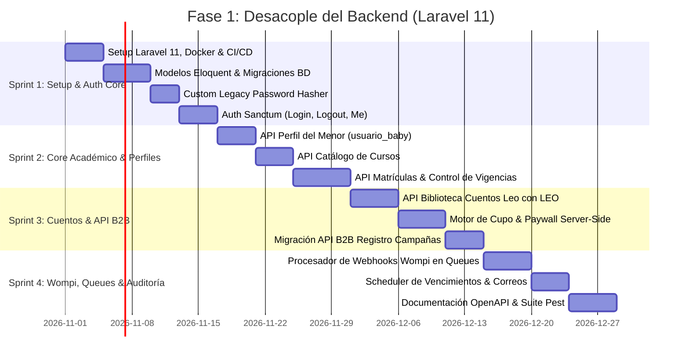

# 🚀 Plan de Trabajo — Fase 1: Desacople de Funcionalidades en el Backend (Laravel 11)

**Proyecto:** Ecosistema Bebé Genial  
**Objetivo de Fase 1:** Construir la base completa del Backend en Laravel 11 desacoplando la lógica de negocio del monolito legacy en un conjunto de APIs RESTful robustas, aseguradas con Sanctum y probadas al 100%.  
**Duración Estimada:** 4 Sprints (8 semanas de desarrollo ágil)  
**Fecha:** Octubre 2026  
**Autor:** Equipo de Arquitectura Nuvex Tecnología  

---

## 1. Alcance y Objetivos Clave de la Fase 1

Al finalizar la **Fase 1**, el backend de Bebé Genial estará en capacidad de operar de forma 100% independiente del frontend actual, permitiendo:

1. Autenticar usuarios (padres, administradores y distribuidores) con soporte transparente para sus contraseñas actuales.
2. Gestionar la creación, consulta y actualización de alumnos y perfiles de menores (`usuario_baby`).
3. Administrar matrículas y verificar en milisegundos si un usuario tiene acceso activo a un curso.
4. Controlar el cupo freemium/full del catálogo de cuentos de Leo con LEO entregando URLs seguras de lectura.
5. Gestionar integralmente las campañas y aliados del API B2B (portando formalmente lo creado en `api/v1/leoconleo/`).
6. Procesar asíncronamente los eventos de pago de Wompi mediante colas de trabajo.

---

## 2. Cronograma y Desglose por Sprints

---

## 3. Detalle de Actividades por Sprint

### 🏃 Sprint 1: Infraestructura Base, Nueva BD (`bebegenial_v2`) y Auth Unificada (Semanas 1 y 2)
* **Tarea 1.1:** Inicialización del proyecto Laravel 11 con PHP 8.3 y entorno Docker (PHP-FPM, Nginx, Redis, MySQL).
* **Tarea 1.2:** Creación y configuración de la **Nueva Base de Datos (`bebegenial_v2`)**: diseño de migraciones nativas limpias, normalizadas y tipadas (eliminando columnas legacy como `cpass`, corrigiendo nombres como `fecha-matricula` a `starts_at`, definiendo llaves foráneas formales y eliminando cualquier riesgo sobre la base de datos de producción).
* **Tarea 1.3:** Configuración de la conexión secundaria `legacy` (modo `read-only`) para consultas de migración y verificación.
* **Tarea 1.4:** Implementación y pruebas unitarias de `LegacyBbpHasher` para garantizar compatibilidad retroactiva con `crypt('Bbp.')` y re-hash automático a `bcrypt`.
* **Tarea 1.5:** Configuración de Laravel Sanctum para autenticación SPA (Cookies HttpOnly) y API Tokens personales.
* **Tarea 1.6:** Endpoints de autenticación:
  * `POST /api/v1/auth/login` (Autenticación universal con rehash automático).
  * `POST /api/v1/auth/logout` (Revocación de tokens / invalidación de sesión).
  * `GET  /api/v1/auth/me` (Obtención del usuario autenticado, rol, permisos y perfil del bebé).
  * `POST /api/v1/auth/change-password` (Cambio de contraseña forzado o voluntario).

### 🏃 Sprint 2: Core Académico, Matrículas y Perfil del Menor (Semanas 3 y 4)
* **Tarea 2.1:** Dominio `BabyProfile`:
  * `GET  /api/v1/profile/baby` (Consultar datos del infante: nombre, edad, avatar, colegio).
  * `PUT  /api/v1/profile/baby` (Actualizar información y selección de avatar).
* **Tarea 2.2:** Dominio `Courses`:
  * `GET  /api/v1/courses` (Listado de cursos disponibles, filtrados por visibilidad y estado).
  * `GET  /api/v1/courses/{id}` (Ficha técnica del curso con contenidos y horas).
* **Tarea 2.3:** Dominio `Enrollments`:
  * `GET  /api/v1/enrollments/my-courses` (Cursos activos del usuario, con fecha de vencimiento y días restantes).
  * `POST /api/v1/enrollments/verify-access` (Servicio interno de validación de vigencia de matrícula).
  * `POST /api/v1/admin/enrollments` (Matriculación administrativa con asignación de tipo `FULL` o `FREEMIUM`).

### 🏃 Sprint 3: Cuentos Interactivos Leo con LEO y API B2B de Campañas (Semanas 5 y 6)
* **Tarea 3.1:** Dominio `Stories`:
  * `GET  /api/v1/stories` (Biblioteca completa agrupada por edades y mundos temáticos).
  * `GET  /api/v1/stories/quota-status` (Saldo actual de cuentos: consumidos, límite permitido, tipo de acceso).
* **Tarea 3.2:** Motor de Cupos y Entrega Segura:
  * `POST /api/v1/stories/{id}/access` (Valida si tiene cupo o relectura. Si es válido, registra consumo y retorna URLs firmadas de páginas y audio; si excede, responde `403 QUOTA_EXCEEDED` con detalles de paywall).
* **Tarea 3.3:** Migración del API B2B al estándar Laravel:
  * `POST /api/v1/leoconleo/registro` (Controlador `B2BRegistrationController` con `B2BRegistrationRequest`, `CampaignService`, `EnrollmentService` y transacciones DB seguras).
  * CRUDs administrativos para Campañas y Aliados (`/api/v1/admin/campaigns`, `/api/v1/admin/partners`).
  * Bitácora de auditoría con paginación (`/api/v1/admin/audit-logs`).

### 🏃 Sprint 4: Pasarela Wompi, Scheduler Asíncrono y QA Automatizado (Semanas 7 y 8)
* **Tarea 4.1:** Integración de Webhooks Wompi:
  * `POST /api/v1/webhooks/wompi` (Endpoint público que valida firma criptográfica y encola el evento en `ProcessWompiWebhookJob`).
  * Job asíncrono que actualiza la matrícula a `tipo_acceso = 'FULL'`, extiende la vigencia y notifica al cliente.
* **Tarea 4.2:** Laravel Scheduler (Reemplazo de Crons Legacy):
  * Comando programado `php artisan enrollments:check-expiration` para suspender matrículas vencidas.
  * Comando `php artisan notifications:send-expiration-reminders` para enviar correos de recordatorio de renovación.
* **Tarea 4.3:** Pipeline de Migración ETL de Datos (`php artisan bebegenial:migrate-legacy`):
  * Desarrollo del comando Artisan de extracción, validación y carga controlada desde la base de datos antigua hacia `bebegenial_v2`.
  * Pruebas de ensayo (*Dry-Run*) en ambiente de Staging y verificación de integridad con checksum de registros migrados.
* **Tarea 4.4:** Documentación y Testing:
  * Generación de especificación **OpenAPI 3.0 / Swagger** y Colección Postman v2.1.
  * Cobertura de pruebas automatizadas con **Pest PHP** superior al 85% en servicios críticos.

---

## 4. Matriz de Endpoints de la Fase 1

| Método | Endpoint | Middleware | Propósito |
| :--- | :--- | :--- | :--- |
| `POST` | `/api/v1/auth/login` | Guest | Login universal con re-hash legacy a bcrypt |
| `POST` | `/api/v1/auth/logout` | `auth:sanctum` | Cierre de sesión y revocación de token |
| `GET` | `/api/v1/auth/me` | `auth:sanctum` | Información del usuario autenticado y perfil del menor |
| `GET` | `/api/v1/profile/baby` | `auth:sanctum` | Obtener datos del menor |
| `PUT` | `/api/v1/profile/baby` | `auth:sanctum` | Actualizar nombre, edad o avatar del menor |
| `GET` | `/api/v1/my-learning/courses` | `auth:sanctum` | Cursos activos y vigencias del usuario |
| `GET` | `/api/v1/stories` | `auth:sanctum` | Catálogo de cuentos bilingües Leo con LEO |
| `GET` | `/api/v1/stories/quota` | `auth:sanctum` | Estado del cupo de lectura freemium |
| `POST` | `/api/v1/stories/{id}/unlock` | `auth:sanctum` | Autorización server-side y URLs firmadas de lectura |
| `POST` | `/api/v1/leoconleo/registro` | `VerifyB2BApiKey` | Registro B2B y asignación de campaña para aliados |
| `GET` | `/api/v1/admin/campaigns` | `auth:sanctum`, `role:admin` | Listado y métricas de campañas |
| `POST` | `/api/v1/admin/campaigns` | `auth:sanctum`, `role:admin` | Creación de campaña con selector de curso y límite |
| `POST` | `/api/v1/webhooks/wompi` | `VerifyWompiChecksum` | Recepción de eventos de pago y actualización en cola |

---

## 5. Criterios de Aceptación (Definition of Done - DoD)

Para dar por concluida la **Fase 1** y dar paso al desarrollo del Frontend en Angular:

1. **Pruebas de Regresión de Contraseñas:** 100% de usuarios de prueba con contraseñas legacy `crypt('Bbp.')` inician sesión correctamente y son migrados a `bcrypt` sin errores.
2. **Pruebas de Carga en API:** Tiempos de respuesta inferiores a **120 ms** en endpoints de lectura y **250 ms** en endpoints transaccionales con colas activas.
3. **Idempotencia de Wompi:** El procesamiento de un webhook duplicado de Wompi no genera dobles matrículas ni inconsistencias.
4. **Colección Postman / Swagger:** Lista para que el equipo frontend de Angular consuma los mocks y APIs reales sin requerir consultar código backend.
