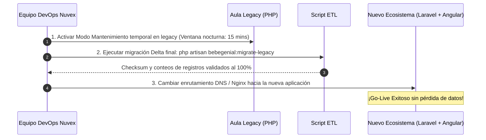

# 🗄️ Estrategia de Base de Datos Nueva (`bebegenial_desacople`) y Proceso de Migración ETL

**Proyecto:** Ecosistema Bebé Genial  
**Base de Datos Origen (Legacy):** `bebegenial_produccion` (MySQL / MariaDB en producción)  
**Base de Datos Destino (Nueva):** `bebegenial_desacople` (MySQL 8 / MariaDB 10.11+)  
**Fecha:** Octubre 2026  
**Autor:** Equipo de Arquitectura Nuvex Tecnología  

---

## 1. Justificación Técnica: ¿Por qué una Base de Datos Nueva?

Trabajar directamente sobre la base de datos actual durante el desarrollo y desacople del backend representa un riesgo inaceptable para la operación comercial activa. Crear una base de datos nueva e independiente ofrece ventajas decisivas:

1. **Cero Afectación a la Operación Activa:** El aula actual en PHP procedural sigue atendiendo alumnos, cobrando por Wompi y registrando campañas sin el menor riesgo de bloqueos de tablas (*locks*), corrupción de datos o interrupciones.
2. **Saneamiento Radical de Deuda Técnica:** El esquema actual acumula años de parches:
   * Columna `cpass` que almacena contraseñas en texto claro (vulnerabilidad crítica que se erradica en la nueva base de datos).
   * Nombres de columnas con caracteres conflictivos para ORMs (ej. `fecha-matricula` con guión medio).
   * Falta de integridad referencial formal (`FOREIGN KEY` ausentes en varias tablas históricas).
   * Inconsistencia en formatos de fecha (ej. `edad` en `usuario_baby` almacenando a veces strings y otras veces fechas).
3. **Adopción de Convenciones Estándar de Laravel 11:** Claves primarias `id` tipadas como `BIGINT UNSIGNED`, marcas temporales `created_at` / `updated_at` / `deleted_at` (*Soft Deletes*), llaves foráneas estrictas e índices optimizados para lecturas concurrentes.

---

## 2. Comparativa de Esquemas: Legacy vs. Nuevo (`bebegenial_desacople`)

```mermaid
flowchart LR
    subgraph Legacy["Base de Datos Legacy (bebegenial_produccion)"]
        U_OLD["usuarios\n(id, nombre, pass, cpass, idperfil...)"]
        B_OLD["usuario_baby\n(id, nombre, edad, avatar...)"]
        M_OLD["matricula\n(id, idusuario, idcurso, fecha-matricula...)"]
        C_OLD["campanas_leoconleo\n(id, codigo_campana, limite_cuentos...)"]
        R_OLD["usuario_cuentos_consumidos\n(id, idusuario, idcuento...)"]
    end

    subgraph ETL["Comando Artisan ETL (Transformación & Limpieza)"]
        TRANS["php artisan bebegenial:etl-migrate\n- Valida hashes\n- Elimina cpass\n- Normaliza fechas\n- Asigna UUIDs/IDs limpios"]
    end

    subgraph NewDB["Base de Datos Nueva (bebegenial_desacople)"]
        U_NEW["users\n(id, first_name, last_name, email, password, role...)"]
        B_NEW["baby_profiles\n(id, user_id, full_name, birth_date, avatar...)"]
        M_NEW["enrollments\n(id, user_id, course_id, campaign_id, starts_at, expires_at...)"]
        C_NEW["campaigns\n(id, partner_id, course_id, code, book_limit...)"]
        R_NEW["story_reads\n(id, user_id, story_id, read_at, ip_address...)"]
    end

    Legacy --> ETL --> NewDB
```



### Tabla de Equivalencias y Limpieza de Campos

| Entidad | Tabla Legacy (`bebegenial_produccion`) | Tabla Nueva (`bebegenial_desacople`) | Mejoras y Limpieza Aplicadas |
| :--- | :--- | :--- | :--- |
| **Usuarios** | `usuarios` | `users` | Se elimina `cpass`. Se unifica `nombre` y `apellidos` en `first_name` y `last_name`. Roles migrados a enum o Spatie Permissions (`superadmin`, `admin`, `parent`, `distributor`). |
| **Perfil Bebé** | `usuario_baby` | `baby_profiles` | Se renombra `edad` a `birth_date` con tipo `DATE` estricto. Llave foránea formal `user_id` enlazada a `users(id)` con `ON DELETE CASCADE`. |
| **Matrículas** | `matricula` | `enrollments` | Se corrige `fecha-matricula` $\rightarrow$ `starts_at` (`DATETIME`). `fecha` $\rightarrow$ `expires_at` (`DATE`). `tipo_acceso` $\rightarrow$ `access_type` (`FULL`, `FREEMIUM`). Llaves foráneas con índices. |
| **Campañas** | `campanas_leoconleo` | `campaigns` | Relaciones formales con `courses(id)` y `api_partners(id)`. Índices únicos sobre `code`. |
| **Aliados API** | `api_partners` | `api_partners` | Limpieza de campos de contacto y hashing seguro para `api_key`. |
| **Consumos** | `usuario_cuentos_consumidos` | `story_reads` | `UNIQUE KEY (user_id, story_id)` garantizando idempotencia en base de datos. |

---

## 3. Arquitectura del Pipeline ETL (Extracción, Transformación y Carga)

El backend en Laravel 11 configurará dos conexiones en `config/database.php`:

```php
// config/database.php
'connections' => [
    // Conexión por defecto: Base de Datos Nueva (Lectura y Escritura)
    'mysql' => [
        'driver' => 'mysql',
        'database' => env('DB_DATABASE', 'bebegenial_desacople'),
        'username' => env('DB_USERNAME', 'root'),
        'password' => env('DB_PASSWORD', ''),
        // ...
    ],

    // Conexión secundaria: Base de Datos Legacy (SÓLO LECTURA)
    'legacy' => [
        'driver' => 'mysql',
        'database' => env('DB_LEGACY_DATABASE', 'bebegenial_produccion'),
        'username' => env('DB_LEGACY_USERNAME', 'readonly_user'),
        'password' => env('DB_LEGACY_PASSWORD', 'secret'),
        // ...
    ],
],
```

### Flujo de Ejecución del Comando ETL

Se implementará un comando Artisan específico: `php artisan bebegenial:migrate-legacy`:

```php
namespace App\Console\Commands;

use Illuminate\Console\Command;
use Illuminate\Support\Facades\DB;

class MigrateLegacyDataCommand extends Command {
    protected $signature = 'bebegenial:migrate-legacy {--chunk=500} {--dry-run}';
    protected $description = 'Extrae y transforma datos desde la BD legacy hacia bebegenial_desacople';

    public function handle() {
        $this->info("Iniciando migración ETL controlada...");

        // 1. Migrar Usuarios y Credenciales
        $this->migrateUsers();

        // 2. Migrar Perfiles de Niños (usuario_baby)
        $this->migrateBabyProfiles();

        // 3. Migrar Cursos, Campañas y Aliados
        $this->migrateCoursesAndCampaigns();

        // 4. Migrar Matrículas y Estados de Vigencia
        $this->migrateEnrollments();

        // 5. Migrar Historial de Cuentos Consumidos
        $this->migrateStoryReads();

        $this->info("✓ Migración ETL completada exitosamente.");
    }
}
```

---

## 4. Estrategia de Switchover (Corte Definitivo en Go-Live)

Cuando la Fase 1 (Backend) y las fases de Frontend estén 100% probadas y validadas, el paso final se ejecuta en 3 pasos:



1. **Pruebas de Ensayo (Dry-Run en Staging):** Durante el desarrollo se realizarán múltiples pruebas de importación completa en un ambiente de Staging para medir tiempos de migración y validar que ningún usuario quede huérfano.
2. **Migración Delta en Go-Live:** Durante una ventana de mantenimiento programada de bajo tráfico (ej. domingo 11:00 PM), se extraen únicamente los registros nuevos generados durante la última semana.
3. **Validación Automática de Checksum:** El comando verifica que el número total de usuarios, matrículas vigentes y consumos de cuentos coincida con exactitud antes de abrir el tráfico al nuevo sistema.
