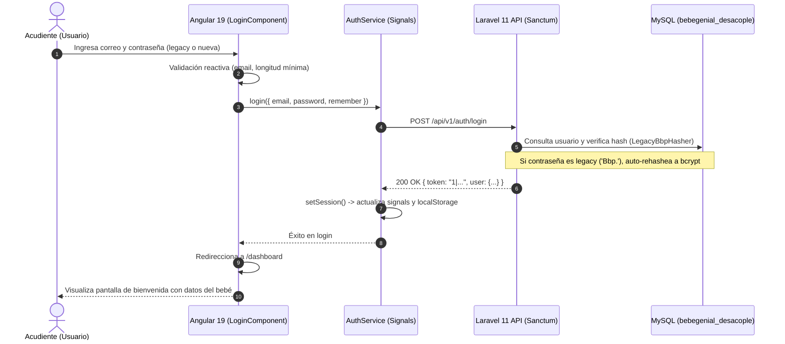

# 🎨 Arquitectura del Frontend y Módulo de Autenticación (Login) — Bebé Genial

Este documento describe la arquitectura base del frontend en **Angular 19**, su integración con el backend desacoplado en **Laravel 11**, y la implementación del primer módulo de usuario: **Login & Sesiones**.

---

## 🏛️ 1. Especificaciones Técnicas

* **Framework:** Angular 19.2+ (Standalone Components, Signals reactivos, `provideHttpClient(withFetch())`).
* **Estilos:** Tailwind CSS v4 con `@tailwindcss/postcss`.
* **Sistema de Diseño:** **Nuvex Modern Curve UI** (Curvas orgánicas `rounded-[32px]`, sombras difusas, paleta esmeralda `#00C975` / pizarra `#0F172A`, sobriedad iconográfica estricta).
* **Enrutamiento:** Angular Router con redirección automática (`/login`, `/dashboard`).
* **Ubicación en Workspace:** [`D:\Users\Usuario\Documents\Nuvex\BebeGenial\frontend\`](file:///D:/Users/Usuario/Documents/Nuvex/BebeGenial/frontend/)

---

## 📂 2. Estructura de Directorios

```text
frontend/
├── public/
│   ├── favicon.ico
│   └── images/
│       ├── logo.png             # Logo oficial Bebé Genial
│       └── logobebe.png         # Isotipo oficial Bebé Genial
├── src/
│   ├── app/
│   │   ├── core/
│   │   │   ├── models/
│   │   │   │   └── auth.models.ts       # Interfaces User, BabyProfile, LoginCredentials, ApiResponse
│   │   │   └── services/
│   │   │       └── auth.service.ts      # AuthService con Signals (currentUser, token, isLoading)
│   │   ├── features/
│   │   │   ├── auth/
│   │   │   │   └── login/
│   │   │   │       ├── login.component.ts       # Lógica reactiva y manejo de errores
│   │   │   │       ├── login.component.html     # Maquetación Nuvex Modern Curve UI
│   │   │   │       └── login.component.spec.ts  # Pruebas unitarias
│   │   │   └── dashboard/
│   │   │       └── dashboard.component.ts       # Preview de sesión activa y test de logout
│   │   ├── app.component.html   # <router-outlet></router-outlet>
│   │   ├── app.config.ts        # Configuración con provideHttpClient(withFetch())
│   │   └── app.routes.ts        # Definición de rutas (/login, /dashboard)
│   ├── environments/
│   │   └── environment.ts       # URL base del API: http://127.0.0.1:8000/api/v1
│   ├── index.html               # Metadatos, título en español y viewport móvil
│   └── styles.css               # Tailwind CSS v4 y animaciones fluidas (fadeIn)
├── .postcssrc.json              # Configuración de PostCSS para Tailwind v4
├── angular.json
├── package.json
└── tsconfig.json
```

---

## 🔐 3. Flujo de Autenticación y Conexión con Laravel 11



---

## 🎨 4. Características de la Interfaz de Login

1. **Estética Nuvex Modern Curve UI:**
   * Contenedor de tarjeta con curvatura `rounded-[32px]` y sombra multidireccional difusa `shadow-[0_20px_60px_-15px_rgba(15,23,42,0.07)]`.
   * Esferas de luz ambiental desenfocadas (`blur-3xl`) en tonos esmeralda y cielo.
   * Inputs ergonómicos `rounded-2xl` con feedback visual inmediato ante errores de validación.
   * Botón de acción principal con gradiente esmeralda (`from-emerald-500 to-teal-600`), sombra de acento y estado de carga (`animate-spin`) para evitar doble clic.
2. **Funcionalidades de Usabilidad:**
   * Alternar visibilidad de contraseña (botón de ojo funcional).
   * Checkbox de "Recordarme en este dispositivo" (persiste en `localStorage` o `sessionStorage`).
   * Modal accesible para **¿Olvidaste tu contraseña?** con envío de correo de recuperación.
   * Manejo automático de banners de error con mensajes explicativos provenientes del backend.
   * Totalmente responsivo para móviles (`touch-target` $\ge 44$px).

---

## 🚀 5. Cómo Ejecutar el Entorno Completo

### A. Iniciar el Backend (Laravel 11)
Desde `D:\Users\Usuario\Documents\Nuvex\BebeGenial\backend`:
```powershell
php artisan serve
# El API correrá en http://127.0.0.1:8000
```

### B. Iniciar el Frontend (Angular 19)
Desde `D:\Users\Usuario\Documents\Nuvex\BebeGenial\frontend`:
```powershell
npm start
# O: ng serve --open
# La aplicación abrirá en http://localhost:4200
```

---

## 🧪 6. Credenciales de Prueba Rápida

Se pueden utilizar las credenciales probadas en los tests unitarios o crear un usuario con `php artisan tinker`:
* **Correo:** `carolina.test@bebegenial.com`
* **Contraseña:** `PasswordLegacy123*` (Se auto-rehashea automáticamente a bcrypt en el login)
