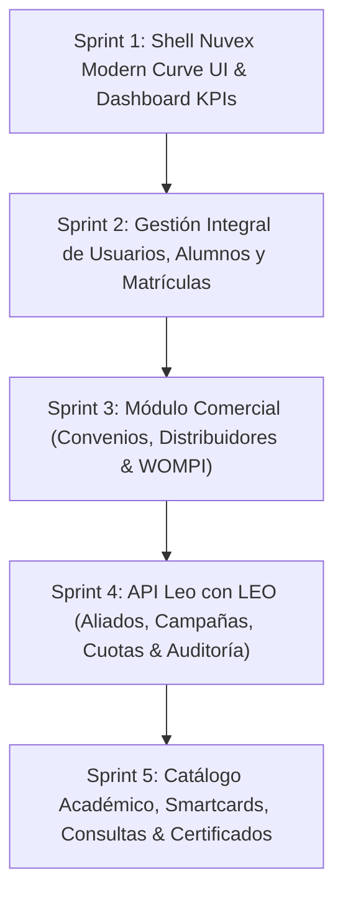

# 🚀 Plan de Trabajo: Migración y Desarrollo del Frontend de Administración — Bebé Genial
## Backoffice Administrativo Moderno con Angular 19 y Nuvex Modern Curve UI

---

## 📋 1. Resumen Ejecutivo y Alcance

El presente plan de trabajo establece la hoja de ruta integral para migrar el 100% de las funcionalidades del panel de administración monolítico en PHP procedural (`D:\xampp\htdocs\aula\admin\`) hacia una **Single Page Application (SPA)** de alto rendimiento construida con:

* **Framework:** Angular 19+ (Standalone Components, Signals, Reactive Forms, Lazy Loading de rutas).
* **Sistema de Diseño:** **Nuvex Modern Curve UI** (Curvatura orgánica de 32px, elevación neumórfica suave, paleta dual Light/Dark, badges circulares de KPIs, sobriedad iconográfica estricta).
* **Consumo:** API RESTful en **Laravel 11** autenticado vía **Laravel Sanctum** (Bearer Tokens con control de acceso RBAC para rol `admin`).

---

## 🏛️ 2. Levantamiento e Inventario de Funcionalidades Legacy (`aula/admin/`)

A partir de la inspección exhaustiva de la estructura de código fuente en `D:\xampp\htdocs\aula\admin\include\sidebar.php` y sus submódulos, se consolida la siguiente matriz funcional a migrar:

```
┌────────────────────────────────────────────────────────────────────────────────────────┐
│                     INVENTARIO DE MÓDULOS DEL ADMINISTRADOR                            │
├─────────────────────────┬──────────────────────────────────┬───────────────────────────┤
│ Módulo Principal        │ Ruta Legacy (Monolito)           │ Entidades y Datos Clave   │
├─────────────────────────┼──────────────────────────────────┼───────────────────────────┤
│ 1. Dashboard Central    │ /admin/index.php                 │ KPIs, métricas globales   │
│ 2. Comercial: Convenios │ /admin/distribuidores/           │ Distribuidores, tiempos   │
│ 3. Comercial: WOMPI     │ /admin/wompi/                    │ Planes, suscripciones    │
│ 4. API Leo con LEO      │ /admin/api_campanas/             │ Orígenes, campañas, logs  │
│ 5. Académico: Usuarios  │ /admin/usuarios/                 │ Acudientes, bebés, pass   │
│ 6. Académico: Cursos    │ /admin/cursos/                   │ Módulos, lecciones, temas │
│ 7. Académico: Trials    │ /admin/trials/                   │ Accesos temporales demo   │
│ 8. Contenidos Padres    │ /admin/aprendamos_juntos/        │ Artículos pedagógicos     │
│ 9. Smart Cards          │ /admin/smart_cards/              │ Videos y flashcards       │
│ 10. Consultas y Filtros │ /admin/usuarios/consultar.php    │ Búsqueda por QR/contrato  │
│ 11. Certificados & DC3  │ /admin/usuarios/diplomas.php     │ Generación de diplomas    │
│ 12. Plantillas Correo   │ /admin/plantillas_correo/        │ Templates HTML de emails  │
└─────────────────────────┴──────────────────────────────────┴───────────────────────────┘
```

---

## 🎨 3. Arquitectura Visual Frontend (Estándar Nuvex Modern Curve UI)

El panel del administrador se estructurará bajo el estándar visual estricto de **Nuvex Tecnología**:

```
┌────────────────────────────────────────────────────────────────────────────────────────────────┐
│  CANVAS ADMINISTRATIVO (Padding 1.5rem, bg-slate-50 claro / bg-slate-950 oscuro)              │
│                                                                                                │
│  ┌────────────────┐  ┌──────────────────────────────────────────────────────────────────────┐  │
│  │                │  │  TOPBAR: Buscador Píldora | Selector Tema | Campana | Perfil Admin   │  │
│  │  SIDEBAR       │  ├──────────────────────────────────────────────────────────────────────┤  │
│  │  CURVA FLOTANTE│  │  FILA DE MÉTRICAS & KPIS:                                            │  │
│  │  (Radio 32px)  │  │  [Spotlight Card Admin]  [KPI Alumnos Activos]  [KPI Convenios B2B]  │  │
│  │                │  │  [KPI Cuentos Leídos]    [KPI Ingresos Wompi]   [KPI Campañas B2B]   │  │
│  │  Logo Bebé     │  ├──────────────────────────────────────────────────────────────────────┤  │
│  │  Menú Píldora  │  │  VISTA DE ENRUTAMIENTO DINÁMICA (<router-outlet>):                   │  │
│  │  Subsecciones  │  │  Tablas elevadas soft-shadow (24px radius), drawer lateral para      │  │
│  │  Modo Dual     │  │  creación/edición rápida, badges tonales y acciones contextuales.    │  │
│  │  Cerrar Sesión │  │                                                                      │  │
│  └────────────────┘  └──────────────────────────────────────────────────────────────────────┘  │
└────────────────────────────────────────────────────────────────────────────────────────────────┘
```

### Principios de Implementación:
1. **Sidebar Flotante Curva:** `rounded-[32px]`, color esmeralda vibrante `#00C975` o azul marino profundo `#0B1E3F` en modo claro, y pizarra `#1E293B` en modo oscuro.
2. **Elevación Neumórfica Suave:** Tarjetas y tablas sin bordes toscos de 1px negro, con sombras difusas `shadow-[0_10px_25px_-5px_rgba(0,0,0,0.04)]` y radio `rounded-2xl` o `rounded-3xl` (20px - 24px).
3. **KPIs con Badge Circular:** Número en negrita (`text-3xl font-extrabold`), comparativa temporal y badge circular suave en la esquina lateral derecha.
4. **Sobriedad Iconográfica:** Cero emojis o stickers decorativos; iconos monocromáticos y limpios con propósito 100% funcional.

---

## 🗺️ 4. Estructura de Módulos y Rutas en Angular 19

```text
frontend/src/app/
├── core/
│   ├── guards/
│   │   ├── auth.guard.ts           # Verifica presencia de token
│   │   └── admin.guard.ts          # Restringe acceso exclusivo a rol 'admin'
│   ├── interceptors/
│   │   └── auth.interceptor.ts     # Inyecta Header Authorization: Bearer <token>
│   └── services/
│       ├── admin-users.service.ts
│       ├── admin-campaigns.service.ts
│       ├── admin-courses.service.ts
│       └── admin-commercial.service.ts
├── layouts/
│   └── admin-layout/
│       ├── admin-layout.component.ts
│       ├── admin-layout.component.html  # Sidebar Curva + Topbar + Content
│       └── components/
│           ├── admin-sidebar/
│           └── admin-topbar/
└── features/admin/
    ├── dashboard/                      # /admin/dashboard
    ├── usuarios/                       # /admin/usuarios (Alumnos, Acudientes, Supervisores)
    │   ├── components/user-drawer/
    │   └── components/matricula-modal/
    ├── convenios/                      # /admin/convenios (Distribuidores y Aliados)
    ├── wompi/                          # /admin/wompi (Planes, Suscripciones, Transacciones)
    ├── campanas-b2b/                   # /admin/campanas (Orígenes, Campañas, Cuotas Leo con LEO)
    ├── cursos/                         # /admin/cursos (Cursos, Módulos, Lecciones)
    ├── trials/                         # /admin/trials (Gestión de Códigos Demo)
    ├── smart-cards/                    # /admin/smart-cards (Videos y Contenidos Interactivos)
    ├── aprendamos-juntos/              # /admin/aprendamos-juntos (Zona Padres)
    ├── consultas/                      # /admin/consultas (Búsqueda global y exportación)
    ├── plantillas-correo/              # /admin/plantillas-correo (Gestor de Plantillas)
    └── certificados/                   # /admin/certificados (Diplomas y Formato DC3)
```

---

## 🗓️ 5. Cronograma de Ejecución por Sprints (Fase Frontend Admin)

Se divide el desarrollo en **5 Sprints Ágiles** orientados a entregables funcionales continuos:



---

### 🔹 Sprint 1: Shell Base Nuvex Modern Curve UI & Dashboard Analítico
* **Objetivo:** Disponer del entorno general de administración, layout responsive con sidebar curva, control de acceso por roles y dashboard principal de métricas.
* **Entregables:**
  1. `AdminLayoutComponent`: Sidebar flotante curva (`rounded-[32px]`), menú colapsable tipo píldora, selector de tema (Light/Dark Mode).
  2. `AdminTopbarComponent`: Barra superior con buscador rápido, notificaciones y perfil de administrador.
  3. `AdminGuard`: Protección de rutas para impedir el acceso a usuarios con rol `parent`.
  4. `AdminDashboardComponent`:
     * Tarjeta Spotlight con información del administrador actual.
     * 6 KPI Stat Cards: Alumnos activos, convenios activos, ingresos por WOMPI, libros Leo con LEO leídos, campañas activas, solicitudes de asesoría.
     * Gráfico analítico de lecturas/ingresos (doble serie en barra esmeralda/ámbar).

---

### 🔹 Sprint 2: Gestión de Usuarios, Alumnos, Perfiles y Matrículas ✅ (COMPLETADO)
* **Objetivo:** Reemplazar el módulo legacy `/admin/usuarios/` con una experiencia moderna de alta productividad para soporte y operaciones, 100% en tema claro y diseño Nuvex Modern Curve UI.
* **Entregables Implementados:**
  1. `UsuariosComponent` (`/admin/usuarios`):
     * Tabla elevada suave con radio `rounded-[32px]`, avatar de iniciales esmeralda, filtros en vivo por rol y estado, búsqueda debounce y paginador responsive.
  2. `UserDrawerComponent` (Panel lateral deslizable):
     * Ficha completa de edición de acudiente y menor (`BabyProfile`).
     * Listado detallado de matrículas vigentes/vencidas con botón de revocación.
     * Botón de reseteo rápido de contraseña a `123`.
  3. `MatriculaModalComponent`:
     * Modal dialog flotante para asignación/renovación de cursos del catálogo.
     * Modalidades `FULL` y `FREEMIUM` (con límite de cuentos para Leo con LEO) y selector de duración (30, 90, 180, 365 días).
  4. Exportador a CSV integrado con un solo clic.
  5. API Laravel (`AdminUserController` & `AdminCourseController`): 7 endpoints protegidos por Sanctum y validados con 20/20 pruebas PHPUnit pasando.
  6. Suite de pruebas Angular Karma: 13/13 pruebas exitosas.

---

### 🔹 Sprint 3: Módulo Comercial (Convenios, Distribuidores y Pasarela WOMPI) ✅ (COMPLETADO)
* **Objetivo:** Administrar empresas aliadas, canales de venta y el ecosistema de cobros recurrentes y únicos de Wompi, bajo tema claro puro y diseño Nuvex Modern Curve UI.
* **Entregables Implementados:**
  1. `ConveniosComponent` (`/admin/convenios`):
     * Listado reactivo de convenios y distribuidores con filtros por tipo (Convenio / Distribuidor) y estado (Activo / Inactivo).
     * `PartnerDrawerComponent`: Panel lateral para crear y editar aliados, definiendo cursos permitidos y meses de vigencia autorizados.
     * `PartnerStudentsModalComponent`: Modal de consulta en tiempo real con buscador y paginador de alumnos matriculados por cada aliado.
  2. `WompiComponent` (`/admin/wompi`):
     * 4 KPI Stat Cards: Ingresos Totales, Suscripciones Activas, Planes Configurados y Tasa de Aprobación.
     * Pestaña de Planes: Visualización y control de estado (activo/inactivo), cursos vinculados y precios.
     * `PlanModalComponent`: Modal para crear/editar planes (recurrentes o pago único, duración en meses, días de prueba, cursos asociados).
     * Pestaña de Transacciones: Monitor en vivo con filtros por estado (`APPROVED`, `DECLINED`, `PENDING`), referencia y paginación.
  3. API Laravel (`AdminCommercialPartnerController` & `AdminWompiController`):
     * 10 endpoints comerciales protegidos por Sanctum.
     * 26/26 pruebas unitarias y de integración en PHPUnit pasando.
  4. Suite de pruebas Angular Karma:
     * Pruebas para `ConveniosComponent`, `WompiComponent` y servicios con Signals.

---

### 🔹 Sprint 4: API Leo con LEO (Aliados B2B, Campañas, Cuotas y Auditoría) ✅ (COMPLETADO)
* **Objetivo:** Portar la interfaz del motor B2B que permite otorgar cursos y cupos de cuentos a aliados estratégicos (Colsubsidio, etc.), 100% en tema claro puro y diseño Nuvex Modern Curve UI.
* **Entregables Implementados:**
  1. `CampanasComponent` (`/admin/campanas`): Hub reactivo con pestañas tipo píldora para Aliados, Campañas y Auditoría.
  2. Pestaña de Aliados & Orígenes API:
     * Listado con Origin Code, código slug, máscara de API Key con copiado en un clic, y contadores de campañas/peticiones.
     * `PartnerModalComponent`: Alta y edición de aliados con lista blanca de IPs (`ip_whitelist`) y datos de contacto.
     * Botones para activación/pausa, regeneración segura de API Key y borrado protegido.
  3. Pestaña de Campañas & Cuotas de Libros:
     * Listado con filtros por aliado y estado, cuota visual con badges ("Ilimitado" o "X libros"), curso pedagógico y fechas de vigencia.
     * `CampaignModalComponent`: Modal para crear/editar campañas asignando cuota (3, 5, 10, 12, 24 libros o ilimitado), curso y vigencia en días.
  4. Pestaña de Auditoría de Peticiones en Tiempo Real:
     * 4 KPI Stat Cards: Total Peticiones, Exitosas (200/201 con % de tasa de éxito), Errores de Validación (400) y Rechazos (401/422/500).
     * Tabla con fecha, status HTTP coloreado, origen, código de campaña, correo solicitado e IP.
     * `AuditDetailModalComponent`: Modal visor para inspección en tiempo real de payloads JSON (Request Body) y respuestas del servidor (Response Body) con tiempo de ejecución en milisegundos.
  5. API Laravel (`AdminApiPartnerController`, `AdminCampaignController`, `AdminApiAuditLogController`):
     * 14 endpoints protegidos por Sanctum y validados con 32/32 pruebas PHPUnit (201 aserciones).
  6. Suite de pruebas Angular Karma: 32/32 pruebas exitosas (100% Green).

---

### 🔹 Sprint 5: Catálogo Académico, Smart Cards, Consultas y Certificados ✅ (Completado)
* **Objetivo:** Cerrar el ciclo de migración con la gestión de contenidos pedagógicos, herramientas de consulta omnicanal, pruebas demo y generación de diplomas oficiales.
* **Entregables Completados:**
  1. `CursosComponent` & `CourseDrawerComponent`:
     * Catálogo pedagógico completo, edición de precios en COP, horas estimadas, conmutadores reactivos para visibilidad y activación de cursos, y borrado protegido.
  2. `SmartCardsComponent` & `AprendamosJuntosComponent`:
     * Gestión pedagógica de tarjetas didácticas interactivas y biblioteca de crianza positiva/tips para padres mediante el componente reutilizable `ContentModalComponent` (videos, PDFs descargables, artículos).
  3. `TrialsComponent` & `TrialModalComponent`:
     * Asignación de accesos temporales (pruebas de 7 a 365 días), prevención de colisiones con matrículas previas y revocación instantánea.
  4. `ConsultasComponent` (OmniSearch):
     * Buscador omnicanal en tiempo real con debounce reactivo (búsqueda por nombre, apellido, correo, teléfono y nombre del menor con tarjetas de expediente).
  5. `CertificadosComponent` & `CertificateModalComponent`:
     * Emisión y revocación de diplomas pedagógicos y certificados oficiales con código alfanumérico autogenerado (`CERT-...`) y mención académica.
  6. `PlantillasCorreoComponent` & `TemplateModalComponent`:
     * Personalización y edición de asuntos y mensajes transaccionales con marcadores e inserción dinámica de variables.
  7. **Métricas de Calidad:**
     * **Backend:** 40/40 pruebas PHPUnit aprobadas (269 aserciones).
     * **Frontend:** 52/52 pruebas Karma aprobadas (100% Green).
     * **Build:** Compilación exitosa en Angular 19 (`npm run build`, 0 errores).

---

## ✅ 6. Criterios de Aceptación (Definition of Done - DoD)

Cada módulo del administrador se considerará completado únicamente cuando cumpla:
1. **Fidelidad Estética Nuvex:** Curvatura de 32px en sidebar, sombras suaves sin bordes duros de 1px y soporte dual Light/Dark verificado.
2. **Seguridad y Guards:** Solo usuarios con rol `admin` autenticados mediante token Sanctum pueden acceder a `/admin/*`.
3. **Manejo de Estados con Signals:** Cargas asíncronas con skeleton loaders o spinners discretos, sin parpadeos.
4. **Respuestas API Envelope:** Integración homogénea con el estándar de respuesta `{ success, message, data, meta }`.
5. **Pruebas Automatizadas:** Mínimo 80% de cobertura en componentes y servicios clave con Jasmine/Karma.
